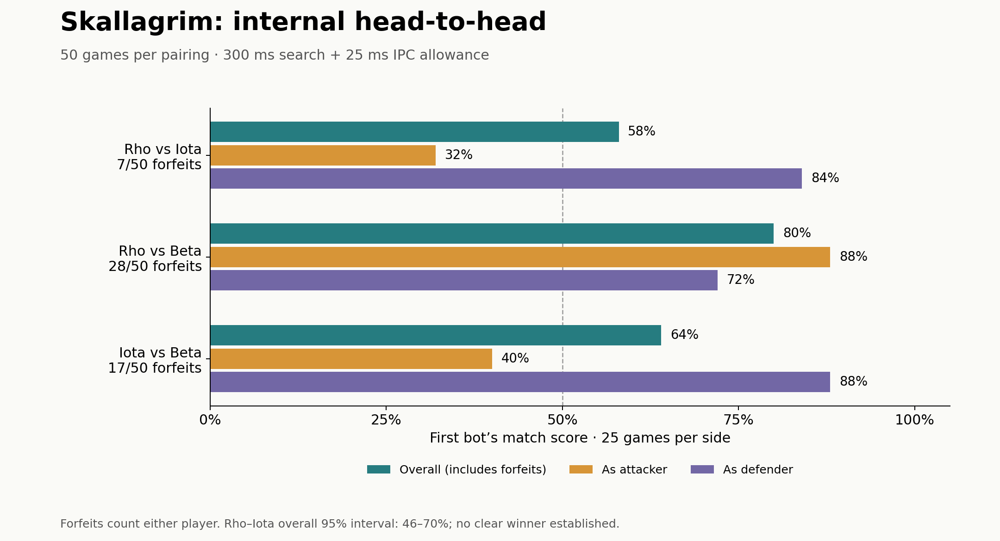
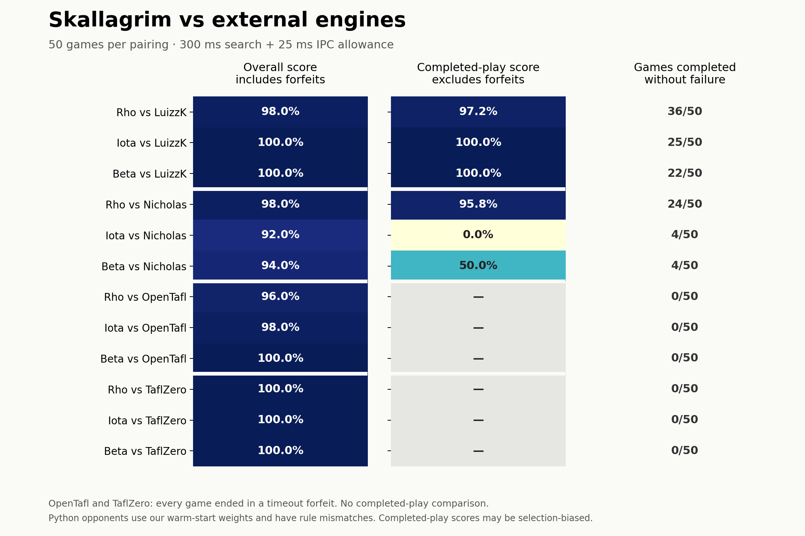

# Skallagrim 0.5.0-beta.1

Experimental Windows beta. See [installation and release qualification](docs/RELEASE.md) and [changelog](CHANGELOG.md). Native manual GUI testing, full league training, live Discord validation and fresh strength qualification remain separately recorded checks.

**Release qualification:** the long soak found a search-response timeout at approximately 114 minutes. Stability qualification remains incomplete; see the release report before treating this candidate as ready.

Skallagrim is a Copenhagen Hnefatafl engine and research platform in Rust and Python, with a polished desktop GUI rendered using tiny-skia. Its goal is strong play as both attackers and defenders, backed by reproducible matches against existing open-source engines.

**Status:** Working Rust rules/search engine, three neural candidates, UCI-style protocol, tiny-skia desktop GUI, streamed Python training and benchmark tooling, and a dedicated authoritative Rust referee process. The audited initial corpus contains 1,250 completed games: 1,000 for training and 250 for validation.

The initial **750-game campaign is complete**: fifteen 50-game pairings with 300-ms search requests and a documented common 25-ms IPC allowance. All games and 35,361 plies replay-verified; results include role scores, confidence intervals and forfeits. [Results](benchmarks/RESULTS.md) do **not establish superiority** because timing failures and upstream rules mismatches limit interpretation. Exit-fort recognition uses sufficient static proofs and independently verified bounded dynamic strategy certificates; qualitative forts and impossible-to-finish draws also support explicit referee adjudication; see [rules limitations](docs/RULES.md).

## Three candidate bots

The current bug-fix pass uses `copenhagen-static-v3`: persistent search history, cancellable CNN inference, reachable-space fort proofs, validated replays, bounded draw-proof tooling, and safer training resumes. See the [fix log and remaining interpretation gaps](docs/FIXES.md). The charts below remain historical v2 results.

| Bot | Evaluation | Search |
| --- | --- | --- |
| **Rho** | Convolutional neural network (CNN), policy and value | Monte Carlo Tree Search (MCTS) |
| **Iota** | Efficiently updatable neural network (NNUE) | Alpha-beta |
| **Beta** | Efficiently updatable neural network (NNUE) | MCTS |

All three share the same Copenhagen rules implementation and must play either side competently. Python supports neural training and experiment tooling; Rust supports game logic, search, inference integration, engine communication, and the desktop application.

The [upstream architecture review](docs/RESEARCH.md) compares the existing CNN/MCTS engines and OpenTafl's classical search with our NNUE candidates.

## Rules and engine communication

The rules authority is the [World Tafl Federation's Copenhagen rules page](https://aagenielsen.dk/copenhagen_rules.php). Correctness includes shieldwalls, throne and corner restrictions, king capture, exit forts, encirclement, repetition, and terminal outcomes.

Skallagrim exposes a [documented UCI-style text protocol](docs/PROTOCOL.md) for tafl. Existing precedents include the [OpenTafl engine protocol](https://github.com/jslater89/OpenTafl/blob/master/opentafl-engine-protocol.txt) and [TaflZero's UCI-style interface](https://github.com/sovelin/taflzero). Adopt or adapt an existing protocol where practical; specify new extensions only where needed.

## Dedicated referee

The separate Rust referee owns moves, captures, repetition and clocks in the GUI, benchmarks and self-play. Press **J** for its evidence panel; **D/F** select a human draw/fort claim that requires a recorded reason before confirmation. Unknown analyses stay unresolved. Every ruling is saved in an audited replay with its rules version, proof or human decision. See [referee controls and protocol](docs/REFEREE.md).

## Training league and Discord presence

The [role-balanced league](docs/LEAGUE.md) trains against champions and historical checkpoints with difficult starts, held-out positions, and separate attacker/defender promotion gates. Shared NNUE candidates must pass as both Iota and Beta. The minimum remains 1,000 training games plus validation.

The GUI supports [Discord Rich Presence](docs/DISCORD.md). Configure `--discord-app-id ID` or `SKALLAGRIM_DISCORD_APP_ID`; disable with `--no-discord`. Without an ID, presence stays disabled. The referee now verifies dynamic fort certificates before automatic rulings, with strategy previews in its panel.

## GUI

The tiny-skia desktop interface includes a wood board, distinct pieces, selection and legal-move feedback, last-move highlights, resizing, keyboard controls, replay navigation, move history, and asynchronous engine search.

## Measuring strength

Compare Rho, Iota, and Beta with each other and with:

- [TaflZero](https://github.com/sovelin/taflzero)
- [nicholasg1997/hnefatafl, experimental branch](https://github.com/nicholasg1997/hnefatafl/tree/experimental)
- [LuizzK/hnefatafl-engine](https://github.com/LuizzK/hnefatafl-engine)
- [OpenTafl](https://github.com/jslater89/OpenTafl)

The required evidence format is **50-game gauntlets at 300 ms per move**. Use paired starts with sides swapped, publish attacker and defender results separately, and record hardware, engine versions, weights, timing, and complete game logs. Small score differences require uncertainty estimates before claiming a better bot.

See [PROJECT_NOTES.md](PROJECT_NOTES.md) for requirements, benchmark conventions, open design questions, and the proposed implementation order.

## "Trust me bro" benchmarks

These initial charts include protocol forfeits and do not establish superior playing strength. Completed-play scores may be selection-biased; upstream rule differences and timeouts are documented in the [full results](benchmarks/RESULTS.md).





Regenerate both images with `python python/plot_benchmarks.py` (requires Matplotlib).

## Build and run

```powershell
cargo build --release --bins
cargo test
.\target\release\skallagrim-gui.exe
.\target\release\skallagrim.exe
```

The GUI selects Iota when a local NNUE is available, otherwise the explicit handcrafted Baseline bot. Neural bots require trained model files; missing weights produce an error. Training uses Python, PyTorch and NumPy. Optional upstream adapters need additional dependencies described in [benchmark documentation](docs/BENCHMARKS.md).

```powershell
python python/selfplay.py --games 1250 --output runs/selfplay.jsonl
python python/train.py --kind nnue --data runs/selfplay.jsonl --output models/nnue.json
python python/train.py --kind cnn --data runs/selfplay.jsonl --output models/cnn.json
```

Training rejects fewer than **1,000 completed training games**, excluding validation, unless explicitly marked as a smoke test. Generation-based continuation and checkpoint provenance are documented in [TRAINING.md](docs/TRAINING.md). The initial corpus is a baseline bootstrap; its size alone does not demonstrate strong play.

## Verification and release

```powershell
cargo fmt --check
cargo clippy --all-targets -- -D warnings
cargo test
python -m unittest discover -s python -p 'test_*.py'
python python/verify_models.py --positions 40
python python/gauntlet_suite.py --output runs/gauntlets --allow-unaudited
python python/report.py --root runs/gauntlets --output benchmarks/RESULTS.md --require-complete
python python/audit_matches.py --root runs/gauntlets --output runs/replay-audit.json
python python/package_release.py --with-data --with-matches --matches-root runs/gauntlets
```

The [release validation report](benchmarks/release-validation.json) records clean-install process, rendering, replay and soak checks separately from untested native interactions. The [results report](benchmarks/RESULTS.md) tracks completed pairings and separates protocol forfeits from played games. Exploratory comparisons require `--allow-unaudited` because the upstream rules and timing limitations are documented in [BENCHMARKS.md](docs/BENCHMARKS.md). Release archives contain runnable Windows executables, trained models, source, documentation and per-file checksums; the optional evidence includes the training corpus and final gauntlet logs.

## License

[Mozilla Public License 2.0](LICENSE).
